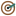

# Propuesta A · Carta

PACHA como una hoja topográfica del IGM: papel verdoso, neatline fina, borde graduado con coordenadas reales, curvas de
nivel en sepia y agua en verde azulado. Es la dirección sobria; transmite precisión y calma, y deja que el mapa y el dato
manden.

- `inicio.html` y `simulador.html` comparten `estilo.css`. Solo llevan JS mínimo en línea: el barrido, los valores de los
  deslizadores, el panel lateral y la hoja inferior.
- `logo.svg` (64 px) y `logo-16.svg` (versión simplificada para 16 px, que también es el favicon).
- `capturas/`: 1440×900 y 390×844 (primer pantallazo y página completa) de las dos páginas, y `logo-tamanos.png`.
- Los SVG de los mapas los genera un script fuera del repo (en el scratchpad de la sesión) a partir de los datos del repo;
  el HTML que hay aquí es el resultado, estático.

## La imagen protagonista: sobre papel, no sobre basalto

El mapa de Inicio está **sobre el papel**. En esta dirección el mapa de Inicio *es* la carta, y una placa de basalto lo
convertiría en otra pantalla oscura dentro de una página clara. Sobre papel funcionan las convenciones de la carta: el mar
con líneas de agua paralelas a la costa, los nombres de agua en cursiva verde azulada, los límites de provincia con trazo y
punto y la franja del radar como una veladura translúcida. El **basalto queda para las superficies de datos**: el campo
del mapa del Simulador es basalto dentro del margen de papel de la hoja, así que el «mapa = basalto» del brief común se
cumple donde hay datos de radar.

Cómo está hecho el mapa:
- El marco va de 81° O a 75° O y de 5° S a 1°36′ N, en la misma proyección lineal que `comun/ecuador.svg`
  (x = 11,7 + (lon + 81,0814) · 98,36 y y = 13 + (1,4596 − lat) · 92,53, sacada de los límites del geojson). Las marcas de
  grado, la línea equinoccial y el borde graduado cada 10′ caen donde deben. Punta Santa Elena (−81,01°) **rompe la
  neatline** unos píxeles, como pasa en las cartas impresas.
- La franja mide **240 km** (la franja de NISAR registrada en `docs/nisar-verificado.md`) y está inclinada −11°, como una
  traza casi polar. El recorrido es ilustrativo y así se rotula. Al pasar por un lugar, su marca late, y el cajetín da la
  longitud del frente en vivo («Franja sobre 78°14′ O»). Con `prefers-reduced-motion` la franja se queda quieta (comprobado
  con Playwright).
- Los tres lugares están en el centro del `bbox` de sus `sitio.json` (`comun/lugares.json`). Las curvas de nivel de las
  tarjetas son **reales**: salen de `data/<sitio>/dem.npz` (relieve Copernicus del equipo), cada 100 m en Mazar, cada 20 m
  en Daule-Peripa y cada 50 m en el Casitagua, con una curva maestra más gruesa. El contorno provisional del embalse
  (`contorno.geojson`) va reproyectado con su EPSG.
- El relieve del Simulador es **sintético** y lleva el rótulo «relieve ilustrativo de la propuesta». Sus coordenadas del
  borde (cada 5′ alrededor de −4,05, −79,25) sí son reales.

## Paleta

| Nombre | Hex | Uso |
|---|---|---|
| Papel | `#EEF0E8` | Fondo de la página |
| Papel elevado | `#F7F8F3` | Recuadros, riel, margen del simulador, tierra en la carta |
| Mar de la carta | `#E9EEE7` | Campo del mapa fuera de la tierra (fondo de los recuadros de relieve) |
| Tinta basalto | `#22262A` | Texto principal, neatline, borde graduado, estado activo |
| Tinta secundaria | `#4E5650` | Texto de apoyo, bordes de recuadros, límites de provincia |
| Filete | `#B9C0B3` | Filetes interiores y separadores (nunca texto) |
| Basalto | `#23272A` | Campo del mapa del simulador |
| Sepia (cacao) | `#8A5A33` | Curvas de nivel, cerros, línea equinoccial, iconos de fenómenos, anillos del logo |
| Sepia claro | `#B98B5E` | Curvas de nivel sobre basalto |
| Laguna | `#2C6E69` | Agua, costa, enlaces, foco, franja del radar, nombres de agua |
| Laguna clara | `#6FB3AA` | Ríos sobre basalto |
| Gris basalto | `#A9B1A8` | Texto secundario y retícula sobre basalto |
| Páramo | `#66784A` | Reservado para gráficos (4,20:1 sobre papel: **no** llega a AA para texto, así que no se usa en texto) |
| Ocre maíz | `#C99A1E` | Única acción principal (con texto basalto); punto elegido del simulador |
| Ocre hover / borde | `#D6A82C` / `#7D5F0F` | Hover del botón y borde que lo separa del papel |
| Demostración fondo / texto / borde | `#F6DFC9` / `#7A3410` / `#C2541C` | Banda y sellos de demostración |

Ajustes sobre la paleta de partida: el ocre contra el papel da 2,25:1 y ningún ocre puede llegar a la vez a 3:1 contra el
papel y a 4,5:1 con texto basalto encima. Por eso el botón lleva un borde `#7D5F0F` (5,2:1) que lo marca como control. El
páramo se quedó solo para gráficos. Se añadieron tres tonos para el basalto (sepia claro, laguna clara y gris basalto).

La banda de demostración usa el **sombreado de «zona sin levantar»** de las cartas (rayado diagonal en el borde
izquierdo): en la carta marca lo que no se ha medido, y aquí marca lo que no es observación real. El detector de
Impeccable lo señala como «franjas decorativas», pero se queda porque tiene significado. La banda es fija arriba, no se
puede cerrar y en móvil se acorta a «DEMOSTRACIÓN · no son datos reales de NISAR».

## Contraste (WCAG 2.2, calculado con script)

| Pareja | Texto | Fondo | Contraste | Uso | Mínimo | Resultado |
|---|---|---|---|---|---|---|
| Tinta sobre papel (cuerpo) | `#22262A` | `#EEF0E8` | 13.25:1 | texto | 4.5:1 | AA |
| Tinta sobre papel elevado (tarjetas, margen) | `#22262A` | `#F7F8F3` | 14.27:1 | texto | 4.5:1 | AA |
| Tinta secundaria sobre papel | `#4E5650` | `#EEF0E8` | 6.59:1 | texto | 4.5:1 | AA |
| Tinta secundaria sobre papel elevado | `#4E5650` | `#F7F8F3` | 7.10:1 | texto | 4.5:1 | AA |
| Sepia sobre papel elevado (rótulos de cerro, sello «fuente por añadir») | `#8A5A33` | `#F7F8F3` | 5.48:1 | texto | 4.5:1 | AA |
| Laguna sobre papel (enlaces) | `#2C6E69` | `#EEF0E8` | 5.16:1 | texto | 4.5:1 | AA |
| Laguna sobre papel elevado (nombres de agua, lectura de la franja) | `#2C6E69` | `#F7F8F3` | 5.56:1 | texto | 4.5:1 | AA |
| Laguna sobre mar de la carta | `#2C6E69` | `#E9EEE7` | 5.04:1 | texto | 4.5:1 | AA |
| Páramo sobre papel (descartado para texto) | `#66784A` | `#EEF0E8` | 4.20:1 | texto | 4.5:1 | FALLA |
| Basalto sobre ocre (botón principal) | `#23272A` | `#C99A1E` | 5.82:1 | texto | 4.5:1 | AA |
| Basalto sobre ocre en hover | `#23272A` | `#D6A82C` | 6.81:1 | texto | 4.5:1 | AA |
| Borde del botón contra el papel | `#7D5F0F` | `#EEF0E8` | 5.20:1 | grafico | 3.0:1 | AA |
| Banda de demostración: texto | `#7A3410` | `#F6DFC9` | 7.01:1 | texto | 4.5:1 | AA |
| Banda de demostración: borde y sombreado contra su fondo | `#C2541C` | `#F6DFC9` | 3.56:1 | grafico | 3.0:1 | AA |
| Banda de demostración: borde contra el papel | `#C2541C` | `#EEF0E8` | 3.99:1 | grafico | 3.0:1 | AA |
| Papel sobre tinta (idioma activo, paso activo) | `#F7F8F3` | `#22262A` | 14.27:1 | texto | 4.5:1 | AA |
| Gris claro sobre tinta (nombre del paso activo) | `#C7CDC4` | `#22262A` | 9.40:1 | texto | 4.5:1 | AA |
| Papel sobre basalto (rótulos del mapa del simulador) | `#EEF0E8` | `#23272A` | 13.09:1 | texto | 4.5:1 | AA |
| Gris basalto sobre basalto (coordenadas, «relieve ilustrativo») | `#A9B1A8` | `#23272A` | 6.84:1 | texto | 4.5:1 | AA |
| Curvas sepia claro sobre basalto | `#B98B5E` | `#23272A` | 4.96:1 | grafico | 3.0:1 | AA |
| Río laguna clara sobre basalto | `#6FB3AA` | `#23272A` | 6.24:1 | grafico | 3.0:1 | AA |
| Punto ocre sobre basalto | `#C99A1E` | `#23272A` | 5.82:1 | grafico | 3.0:1 | AA |
| Anillo de foco (laguna) sobre papel elevado | `#2C6E69` | `#F7F8F3` | 5.56:1 | grafico | 3.0:1 | AA |

El texto en cursiva sobre los mapas lleva un halo del color del papel (`paint-order: stroke`), así que contrasta contra
el papel aunque pase sobre una línea.

## Tipografía

- **Alegreya** (Juan Pablo del Peral, Huerta Tipográfica, Argentina) para títulos, cajetines, cifras destacadas y
  nombres geográficos. Los nombres de agua van en cursiva, como manda la convención cartográfica.
- **Public Sans** para el cuerpo, los controles y las coordenadas, siempre con `tabular-nums`. No hay monoespaciada.
- Escala de razón 1,25 sobre un cuerpo de 17 px: 13 · 14 · 17 · 21 · 26 · 33 px, y el titular fluido de 40 a 54 px
  (`clamp`), con interlineado de 1,04. El cuerpo va a 1,55 y la entrada a 21 px, con una medida de unos 34–46 caracteres.

## Logo

Tres anillos de nivel algo irregulares en sepia, atravesados por un haz de radar en verde azulado con su cuña de
barrido, y «PACHA» en Alegreya Bold con un espaciado de 0,08 em. A 16 px el dibujo se simplifica a dos anillos
gruesos y el haz (`logo-16.svg`). Se ve en `capturas/logo-tamanos.png` a 16, 32 (16 ampliado) y 64 px.

 

## Simulador

El mapa es una hoja de la carta: margen de papel con coordenadas en grados y minutos, un borde graduado cada minuto y el
campo de basalto con las curvas, el punto elegido, la flecha del viento y un localizador con el contorno real del Ecuador.
El panel de la derecha es el **margen** de la hoja: se puede ocultar con el botón del mapa y solo tiene tres controles con
su unidad y una frase llana. «Avanzado» está cerrado. Debajo del mapa va el sello de origen y el «Resultado» en
frases, todo rotulado como «ejemplo de demostración». En móvil el margen pasa a ser una hoja inferior medio abierta, con un
asa que la sube.

Los controles salen del catálogo real (`datos/simulador.py`). El viento viene en m/s (de 0 a 20, por defecto 6) y aquí se
muestra en km/h (de 0 a 72, por defecto 22) porque así lo pide el brief. Si se adopta la propuesta, la conversión va en la
API, no en el frontend.

## Riesgos

- **Es la más familiar.** Puede leerse como «otro atlas escolar». Lo que la salva es la precisión (las coordenadas reales,
  las curvas reales y la franja de 240 km); si eso se pierde al pasar a React, queda un mapa bonito sin más.
- **Letra pequeña en el móvil.** Los rótulos del SVG se escalan con el mapa. Se compensan con consultas de medios dentro
  del SVG, pero a 390 px las coordenadas de la carta de Inicio rondan los 10–11 px.
- **El borde graduado y la retícula son densos.** Junto a las teselas reales de Esri, en la app hay que aligerarlos para que
  no compitan con el dato.
- El relieve del Simulador es inventado. En la app debe salir del SRTM real; si no, el rótulo «ilustrativo» tiene que seguir.
